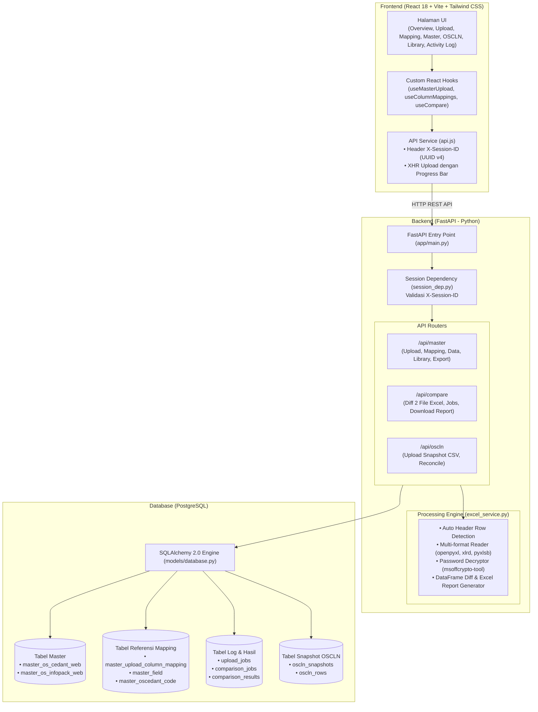

# Analisis Proyek & Arsitektur Sistem — OS Claim Hub

Dokumen ini berisi penjelasan menyeluruh mengenai fungsi bisnis, arsitektur teknis, alur kerja utama, serta hasil audit (scan) kekurangan sistem dan UI/UX beserta tahapan pengembangannya.

---

## 1. Gambaran Umum (Bahasa Sederhana)

### Kenapa Sistem Ini Dibuat?
Dalam operasional reasuransi, puluhan perusahaan asuransi rekanan (*cedant*) mengirimkan laporan klaim yang belum selesai dibayar (*Outstanding Claim* / OS Claim) dan laporan *Infopack* setiap bulan dalam bentuk file Excel.

Masalah di lapangan:
1. **Format Berbeda-beda**: Setiap perusahaan memiliki nama kolom, letak baris judul (*header*), dan jenis ekstensi file (`.xlsx`, `.xls`, `.xlsm`, `.xlsb`) yang tidak seragam, bahkan ada yang dikunci dengan *password*.
2. **Rawan Duplikasi & Human Error**: Menggabungkan puluhan file secara manual ke satu tabel utama (*Master Data*) sangat memakan waktu dan berisiko memasukkan data ganda.
3. **Proses Rekonsiliasi Lambat**: Mencocokkan ribuan baris klaim dari *cedant* dengan catatan sistem internal kantor (**OSCLN**) satu per satu secara manual membutuhkan waktu berhari-hari.

### Apa Fungsi Utama Sistem Ini?
Sistem **OS Claim Hub** bekerja layaknya **"Asisten Otomatis Perapih & Pencocok Buku Catatan"** dengan tiga tugas utama:
1. **Penerjemah & Penyaring Otomatis (Upload ke Master Data)**  
   Membaca berbagai format file Excel dari *cedant*, menerjemahkan nama kolom yang berbeda-beda ke dalam satu standar tabel **Master Data**, serta membuang baris duplikat secara otomatis.
2. **Detektif Pencari Perbedaan (Compare Excel)**  
   Membandingkan dua file Excel berdasarkan *Primary Key* untuk mendeteksi baris yang sama persis (*Matched*), berubah nilainya (*Changed*), atau hanya ada di salah satu file (*Only in A / B*).
3. **Alat Rekonsiliasi Dua Arah (OSCLN Reconciliation)**  
   Mencocokkan data di **Master Data** dengan file *snapshot* CSV dari sistem internal **OSCLN** untuk menemukan klaim yang sudah cocok (`MATCHED_1_TO_1`), belum tercatat di OSCLN (`NOT_FOUND`), atau tidak ditemukan di Master (`INVALID_KEY`).

---

## 2. Arsitektur Sistem

Aplikasi ini dibangun menggunakan pola **Decoupled Client-Server (REST API)** dengan pemisahan antara antarmuka pengguna (*Frontend*), mesin pemroses (*Backend*), dan penyimpanan relasional (*PostgreSQL*).

### Rincian Lapisan Arsitektur

| Lapisan | Teknologi | Lokasi Kode | Tanggung Jawab Utama |
|---|---|---|---|
| **Presentation Layer** | React 18, Vite 5, Tailwind CSS | `frontend/src/pages/`, `frontend/src/components/` | Menyediakan navigasi sidebar, form upload interaktif, tabel data terpaginasi, dan kartu ringkasan metrik. |
| **State & API Client** | React Hooks, Fetch & XHR | `frontend/src/hooks/`, `frontend/src/services/api.js` | Mengelola siklus hidup form, progress bar upload, dan menyertakan identitas sesi `X-Session-ID`. |
| **API & Routing Layer** | FastAPI | `backend/app/main.py`, `backend/app/routers/` | Menerima request multipart file, memvalidasi parameter, dan mengatur transaksi database. |
| **Service / Processing Layer** | Pandas, OpenPyXL, xlrd, pyxlsb, msoffcrypto | `backend/app/services/excel_service.py` | Membuka enkripsi workbook, mendeteksi posisi baris header, mengekstrak & menormalisasi data, serta menyusun laporan Excel. |
| **Data Access Layer** | SQLAlchemy 2.0, Psycopg2 | `backend/app/models/database.py`, `backend/app/models/models.py` | Memetakan model ORM dan menjalankan query SQL ke database PostgreSQL. |

---

## 3. Skema Database Utama

1. **`master_os_cedant_web`**: Menyimpan data klaim OS Cedant (`cedant_code`, `doc_no`, `dol`, `outstanding`, `currency`, `month`, `year`, `file_name`, `sheet_name`).
2. **`master_os_infopack_web`**: Menyimpan data Infopack (`cedant_code`, `class_code`, `title`, `value`, `row_index`, `month`, `year`, `file_name`, `sheet_name`).
3. **`master_upload_column_mapping`**, **`master_field`**, **`master_oscedant_code`**: Tabel referensi yang memetakan nama kolom Excel spesifik tiap *cedant* ke kolom standar database.
4. **`upload_jobs`**: Menyimpan log setiap proses upload ke Master (jumlah baris diproses, ditambahkan, dilewati, dan pesan error).
5. **`comparison_jobs`** & **`comparison_results`**: Menyimpan ringkasan dan rincian baris hasil komparasi maupun rekonsiliasi OSCLN.
6. **`oscln_snapshots`** & **`oscln_rows`**: Menyimpan metadata dan isi baris file CSV snapshot OSCLN yang diunggah pengguna.

---

## 4. Hasil Scan Kekurangan Sistem & UI/UX

Berdasarkan pemeriksaan menyeluruh terhadap source code saat ini dan perbandingan dengan standar desain **Indonesia Re Frontend (`example/`)**, berikut adalah temuan kekurangan yang perlu ditingkatkan:

### A. Kekurangan dari Segi UI / UX
1. **Identitas Warna Belum Sesuai Standar Korporat Indonesia Re**:
   - Aplikasi sebelumnya menggunakan warna hijau/teal (`#166534` & `teal-600`), sedangkan referensi produk internal Indonesia Re menggunakan palet **Corporate Blue** (`#0664D0`, `#0556B5`, navy `#17365D`, dengan latar belakang permukaan `#F5F6F8`).
2. **Sidebar & Layout Utama Masih Kaku**:
   - Sidebar sebelumnya tidak dapat di-*collapse* (diperkecil) di layar desktop dan belum memiliki menu *drawer* responsif untuk layar kecil/mobile.
   - Belum ada **Top Header Bar** terpadu yang menampilkan *Breadcrumb* navigasi halaman aktif dan kontrol *toggle* sidebar seperti pada referensi `indonesiare-frontend`.
3. **Duplikasi Header di Setiap Halaman**:
   - Setiap halaman membuat bar header sendiri dan mengulang judul yang sama tepat di bawahnya (contoh: teks `"DATA INGESTION - Upload Data"` muncul dua kali secara berurutan di halaman Upload).
4. **Ketidaksesuaian Kolom Tabel Master pada Tab InfoPack**:
   - Saat pengguna memilih tab **InfoPack** di halaman Master, kolom tabel yang ditampilkan masih menggunakan kolom milik **OS Cedant** (`Loss Ref`, `Outstanding`, `Date of Loss`), padahal data InfoPack berisi `Class Code`, `Title`, dan `Value`.
5. **Tombol Eksternal yang Belum Fungsional**:
   - Tombol `"Open Google Sheets"` di halaman Master dan OSCLN hanya membuka URL `https://sheets.google.com` kosong tanpa integrasi data.

### B. Kekurangan dari Segi Sistem & Logika Backend/Frontend
1. **Pencarian (Search) di Halaman Master Hanya Memfilter Halaman Aktif**:
   - Input pencarian di `MasterPage.jsx` hanya memfilter 50 baris yang sedang dimuat di memori browser, belum mengirim parameter query pencarian ke endpoint `/api/master/data` di backend.
2. **Overview & Activity Log Belum Menampilkan Riwayat Upload Master**:
   - Halaman *Overview* dan *Activity Log* hanya memanggil `/api/compare/jobs`, sehingga aktivitas upload file Excel ke Master (`/api/master/jobs`) tidak muncul di daftar aktivitas terbaru.
3. **Fitur Komparasi 2 File Excel Kehilangan Halaman UI**:
   - Backend memiliki endpoint `/api/compare/upload` dan frontend memiliki hook `useCompare.js`, namun halaman `ComparePage.jsx` saat ini hanya menampilkan form *Upload ke Master*.
4. **Isolasi Data Master Lintas Sesi**:
   - Tabel `upload_jobs` memakai `session_id`, tetapi tabel `master_os_cedant_web` dan `master_os_infopack_web` bersifat global. Penghapusan file dari *Library* menghapus baris berdasarkan `file_name`, `month`, dan `year`.
5. **Rekonsiliasi OSCLN Baru Mencocokkan Keberadaan Key**:
   - Rekonsiliasi saat ini baru mengecek apakah *Primary Key* ada di kedua sumber (`matched`, `only_in_a`, `only_in_b`), belum membandingkan selisih nilai nominal klaim (`outstanding`).
6. **Navigasi Belum Berbasis URL (`react-router-dom`)**:
   - Navigasi masih menggunakan state lokal (`useState("overview")`), sehingga ketika halaman di-*refresh* (F5), posisi halaman kembali ke *Overview*.

---

## 5. Rencana Peningkatan Bertahap (Roadmap)

Agar pengembangan tetap terkontrol dan tidak terlalu kompleks dalam satu waktu, peningkatan dibagi menjadi 3 tahap:

- **Tahap 1 — Pembaruan Layout Shell, Sidebar Biru & Standarisasi Tema (Selesai / Aktif)**
  - Mengubah tema warna aplikasi dan Sidebar menjadi **Corporate Blue Indonesia Re** (`#17365D` / `#0664D0`).
  - Menambahkan fitur *collapsible sidebar* (bisa diperkecil/diperlebar) + dukungan *mobile drawer* dan logo Indonesia Re.
  - Menambahkan *Top Header Bar* bersih dengan *Breadcrumb* dinamis dan merapikan duplikasi header di tiap halaman.
- **Tahap 2 — Perbaikan Fungsionalitas Tabel, Pencarian & Sinkronisasi Log**
  - Memperbaiki tampilan kolom tabel **InfoPack** di halaman Master (`Class Code`, `Title`, `Value`).
  - Mengaktifkan pencarian *server-side* pada endpoint `/api/master/data`.
  - Menggabungkan log `upload_jobs` ke ringkasan *Overview* dan *Activity Log*.
- **Tahap 3 — Peningkatan Lanjutan (Routing & Rekonsiliasi Nilai)**
  - Menerapkan URL routing (`react-router-dom`) agar posisi halaman bertahan saat di-*refresh*.
  - Menambahkan tab/mode komparasi 2 file Excel berdampingan dan perbandingan nilai nominal pada rekonsiliasi OSCLN.
